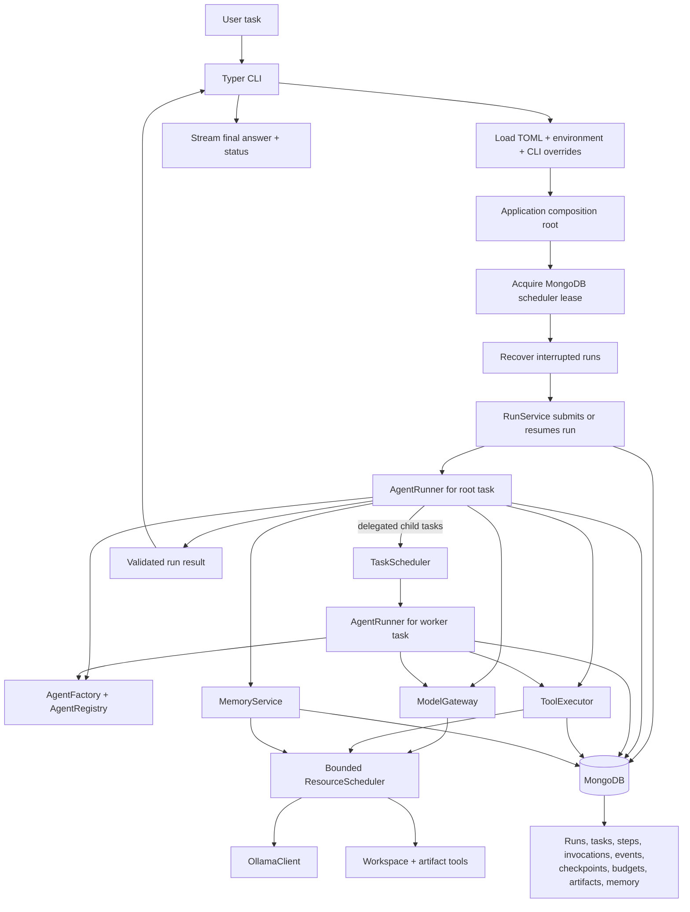
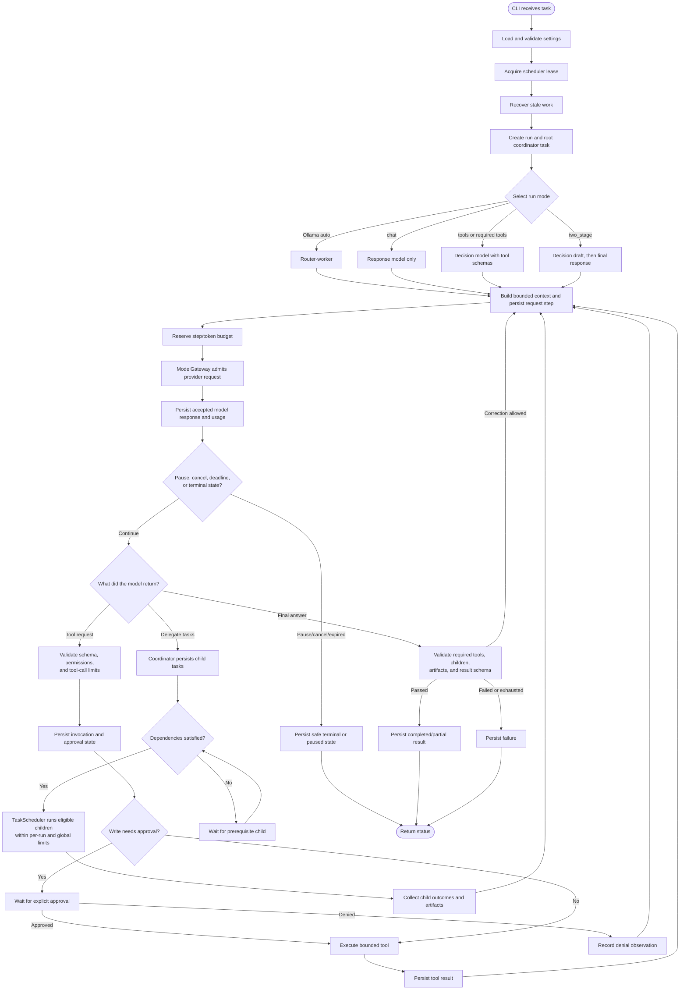
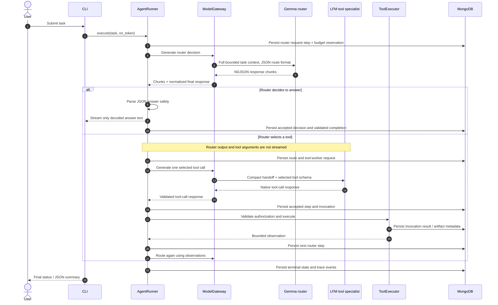
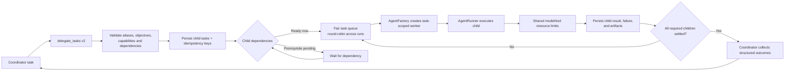
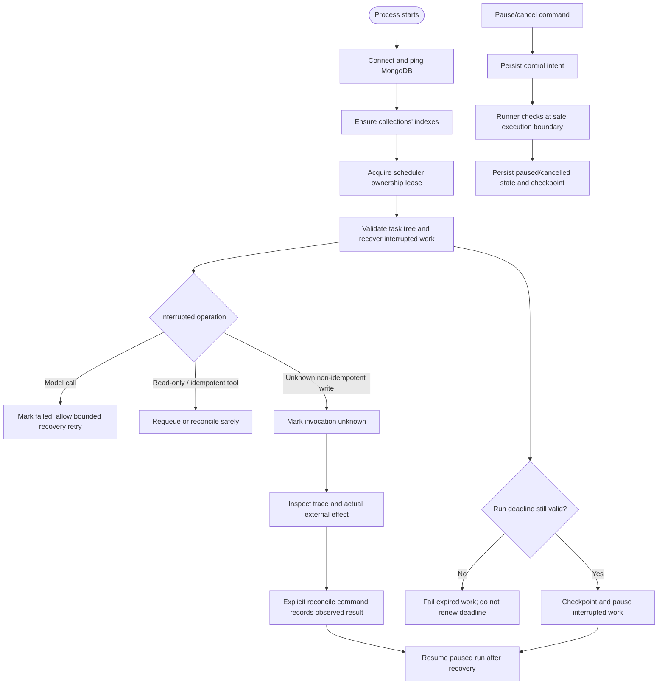

# Agent architecture flowcharts

These diagrams describe the current implementation in `src/agent_harness`.
Ollama is local to the configured machine; MongoDB is the durable state store.

## System overview

The SQLite adapter remains available for development/legacy compatibility; the
normal application composition uses MongoDB. See the collection inventory in
[components.md](components.md#mongodb-persistence).

## Run lifecycle

## Ollama router-worker and streaming

Streaming is intentionally limited to user-facing final-answer content.
Intermediate router JSON is decoded incrementally so JSON escapes are rendered
as ordinary text. Tool-call arguments, routing decisions, and intermediate
drafts are not sent to the terminal.

## Delegation and parallel children

Independent ready workers can run concurrently. Dependencies impose ordering.
Concurrency is bounded by the coordinator's active-child limit, the task
scheduler, and the model provider limit; a request for workers does not bypass
these bounds.

## Persistence, recovery, and control

MongoDB transactions make state changes and their lifecycle events durable
together. The scheduler lease fences off competing run workers. The terminal
and inspect/control commands do not make a tool's external side effect atomic
with MongoDB; unknown writes must be checked before reconciliation.
